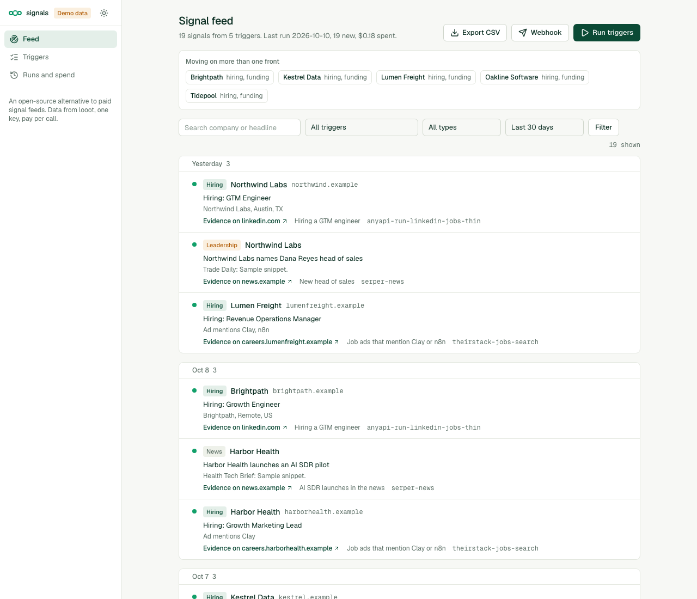
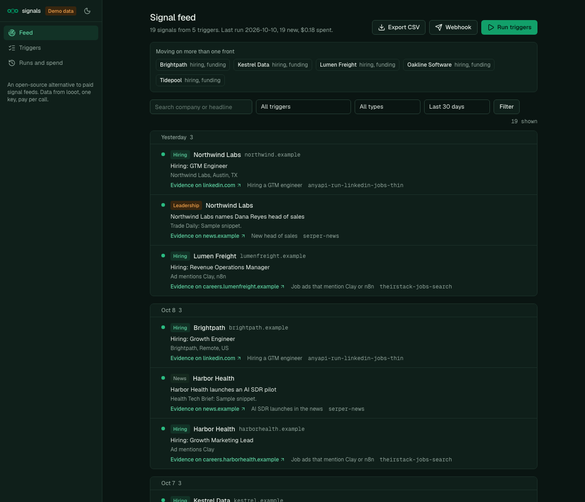

# looot-signals

An open-source alternative to TheirStack and Harmonic style signal feeds. You define triggers ("hiring a GTM engineer", "job ads that mention Clay or n8n", "raised a seed or Series A in the last 30 days", "new head of sales"). The app pulls matching companies through looot, dedupes them, and shows a dated feed with the evidence link for each signal. Export to CSV or a webhook. A headless CLI runs the same trigger file and writes only the signals that are new since the last run.

TheirStack lists API plans from $49 a month (1,500 API credits) and one-time app credit packs from $109 (1,000 company credits), read on 2026-10-10. Harmonic shows no public price. looot-signals has no subscription. It calls looot endpoints at list price, so a run costs what its calls cost, shown before it starts.




## Try it without an account

```bash
npm install --ignore-scripts
npm run demo            # web UI on http://localhost:3220, sample data, no token
npm run signals -- --demo --out signals-out
```

The demo uses made-up companies on the reserved `.example` domain. Evidence links in demo mode go nowhere on purpose.

## Run it for real

```bash
cp .env.example .env.local        # set LOOOT_TOKEN
cp triggers.example.yaml triggers.yaml
npm run signals -- --dry-run      # prints every call and the list-price total, calls nothing
npm run signals -- --cap 1 --out signals-out
npm run dev                       # web UI on http://localhost:3000
```

Create an agent token at https://looot.ai/settings. Top up from $5. A failed call costs nothing.

CLI options: `--triggers`, `--out`, `--state`, `--cap` (dollars, default 1), `--format json,csv,md`, `--webhook`, `--dry-run`, `--demo`. Each run writes `signals-<timestamp>.json`, `.csv` and `.md` with the new signals only, and updates `data/state.json`.

## Triggers

`triggers.example.yaml` shows every field. Four types:

| Type | What it looks for | Default source |
| --- | --- | --- |
| hiring | Job titles, and words in the job ad | LinkedIn job index, or the job ad text search when `keywords` is set |
| funding | Financing events by stage | Financing events feed |
| news | A Google News query | Google News |
| leadership | Appointments such as "head of sales" | Google News headlines, or the structured job-change feed |

## Signals and cost

Prices are looot list prices read from the public catalog on 2026-10-10. Result-priced endpoints are quoted at the row limit of the trigger, so the real charge is usually lower.

| Signal | looot job | Endpoint | List price |
| --- | --- | --- | --- |
| Hiring by title | jobs.search | anyapi-run-linkedin-jobs-thin | $0.0005 per call |
| Hiring by words in the ad | jobs.search | theirstack-jobs-search | $0.0327 per result |
| Funding | company.funding | predictleads-discover-financing-events | $0.01 per result |
| News and leadership | news.search | serper-news | $0.001 per call |
| Leadership, structured | people.job.changes | signalbase-signals-job-changes | $0.108 per call |

The five triggers in the example file cost at most $0.531 per run at list price. With the sample answers the same run reads as $0.18, because most calls return fewer rows than their limit. Treat $0.18 as an illustration. No real run was priced.

## How money is handled

- The quote is shown before any paid action: `--dry-run` in the CLI, a price dialog in the UI that sends back the amount you confirmed. If the live price is higher than that amount, nothing is called.
- Each run has a cap (`--cap`, `SIGNALS_CAP_USD`). A call that would cross it is skipped and listed as `skipped_budget`.
- Every call has a stable `idempotencyKey` made from the trigger, the endpoint, a hash of the input and the day. Running the same trigger twice in a day replays the stored run and does not charge twice.
- A call still running when waiting stops is `pending`, never failed. Its run id is stored and read again, free, on the next run.
- Calls are pinned to one endpoint with no provider fallback, so the price is the one quoted.

## Dedupe

A signal id is a hash of the signal type, the company (domain, else name) and the evidence URL with tracking parameters removed. The same job seen by two triggers or two runs is one signal. The second trigger is recorded on it.

## Export and webhook

The feed page exports the current filter as CSV (cells that start like a spreadsheet formula get a leading quote). `SIGNALS_WEBHOOK_URL` sets a webhook that receives the new signals of a run as JSON. Only https is accepted, plus http on localhost. With `SIGNALS_WEBHOOK_SECRET` each request carries `X-Signals-Signature: sha256=<hmac of the body>`. The URL is server config and is never taken from a request.

## Install for agents

Copy `skills/looot-signals` into `.claude/skills/` (Claude Code) or point your agent at `llms.txt`. The skill quotes with `--dry-run`, runs with a cap, and reports new signals with their evidence links.

## What is not tested

- No paid looot run was made. Response parsing is built from each provider's public docs and from fixtures in `src/demo/fixtures.ts`. Parsers read several field names per value and return nothing for an answer they do not understand, but no real response body was checked. Expect to adjust them on the first real run.
- The `postedLimit` wording for the LinkedIn job index and the `date` field names of the job-change feed come from parameter descriptions, not from a live call.
- News headlines have no structured company. The company is a guess from the headline and is empty when the pattern does not fit.
- Demo and tests run against fixtures. 52 unit tests cover parsers, dedupe, the engine (cap, idempotency keys, pending, failures), CSV, the webhook, the looot client and the CLI, with HTTP mocked.

## What was dropped

Harmonic style person-level and investor data (founders, board, investor graphs) is not covered by a single looot job at an affordable price, so there is no investor view. Funding is limited to financing events.

## Develop

```bash
npm test && npm run typecheck && npm run lint && npm run build
npm run leak-scan
```

`git config core.hooksPath .githooks` runs the leak scan before every commit.

## Licence

MIT. Copyright looot.
