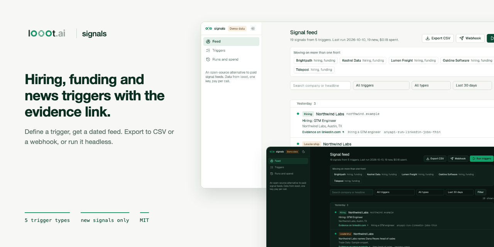

<p align="center"></p>

# looot-signals

[](LICENSE) [](https://github.com/loootai/looot-signals/releases) [](https://docs.looot.ai)

An open-source alternative to TheirStack and Harmonic style signal feeds. You define triggers ("hiring a GTM engineer", "job ads that mention Clay or n8n", "raised a seed or Series A in the last 30 days", "new head of sales"). The app pulls matching companies through looot, dedupes them, and shows a dated feed with the evidence link for each signal. Export to CSV or a webhook. A headless CLI runs the same trigger file and writes only the signals that are new since the last run.

TheirStack lists API plans from $49 a month (1,500 API credits) and one-time app credit packs from $109 (1,000 company credits), read on 2026-10-10. Harmonic shows no public price. looot-signals has no subscription. It calls looot endpoints at list price, so a run costs what its calls cost, shown before it starts.


## What you need

- Node 22.12 or newer. The repo has no `engines` field or `.nvmrc`. Next.js 16 needs 20.9 or newer and the test runner (Vitest 5) needs 22.12 or newer. I ran it on Node 24.
- npm.
- A looot account and token, only for real runs. Sign up at https://looot.ai/auth/sign-up. To get a token, run `looot login` (`npm i -g looot`), which opens a browser approval. Or in the looot web app go to Settings, "Agent tokens", and create one (https://docs.looot.ai/get-started/sign-in). With no browser or in CI, create the token in Settings, Agent tokens, then `export LOOOT_TOKEN=...`. The token needs the scopes runs.execute, catalog.read, runs.read and usage.read.
- A funded balance. Minimum top-up is $5. Signing up adds no credit (https://docs.looot.ai/money).

No other account is needed. The app does not use Supabase or an LLM key. A webhook is optional.

## Try it in one minute

No account and no token.

```bash
git clone https://github.com/loootai/looot-signals && cd looot-signals
npm install --ignore-scripts
npm run demo                              # web UI on http://localhost:3220
npm run signals -- --demo --out signals-out
```

The demo uses made-up companies on the reserved `.example` domain. Evidence links in demo mode go nowhere on purpose. The CLI demo prints "19 new signals. Spent $0.18 of $1.00." and writes `.json`, `.csv` and `.md` files to `signals-out/`.

The CLI demo also writes `data/state.json`. Delete `data/` before your first real run so demo signals do not count as already seen.

## Run it with your own data

```bash
cp .env.example .env.local          # web app only, then set LOOOT_TOKEN
export LOOOT_TOKEN=...              # CLI: it does not read .env.local
cp triggers.example.yaml triggers.yaml
```

The web app reads `.env.local`. The CLI reads only the shell environment.

| Variable | Required | What it does | Where to get it |
|---|---|---|---|
| `LOOOT_TOKEN` | Required for real runs, not for `--dry-run`, `--demo` or the demo UI | Bearer token for the looot API | Settings, Agent tokens in the looot app, or `looot login` |
| `LOOOT_API_URL` | Optional | looot API base URL used to read live prices. Default `https://api.looot.ai` | Leave unset |
| `SIGNALS_CAP_USD` | Optional | Most one run from the web app may spend. Default 1. The CLI uses `--cap` instead | A dollar amount you choose |
| `SIGNALS_TRIGGERS` | Optional | Trigger file the web app reads. Default `triggers.yaml`, else `triggers.example.yaml` | A path you choose |
| `SIGNALS_STATE` | Optional | State file the web app uses. Default `data/state.json` | A path you choose |
| `SIGNALS_WEBHOOK_URL` | Optional | Receives the new signals of a run as JSON. https only, or http on localhost | Your own endpoint |
| `SIGNALS_WEBHOOK_SECRET` | Optional | Signs each webhook with `X-Signals-Signature: sha256=<hmac of the body>` | A secret you choose |
| `NEXT_PUBLIC_DEMO` | Optional | `1` turns on demo mode. `npm run demo` sets it | Do not set it for real use |

The trigger file is `triggers.yaml` (copied from `triggers.example.yaml`, see Triggers below). Dry run first. It needs no token and calls nothing:

```bash
npm run signals -- --dry-run
```

Real output, using `triggers.example.yaml`:

```
Calls this run (list prices dated 2026-10-10):
  gtm-engineer-hiring      anyapi-run-linkedin-jobs-thin                $0.0005  GTM engineer
  gtm-engineer-hiring      anyapi-run-linkedin-jobs-thin                $0.0005  growth engineer
  clay-n8n-job-ads         theirstack-jobs-search                       $0.3270  revenue operations, growth, Clay, n8n
  recent-rounds            predictleads-discover-financing-events       $0.2000  seed, series_a
  new-head-of-sales        serper-news                                  $0.0010  ("appoints" OR "names" OR "hires" OR "promotes") "head of sales"
  new-head-of-sales        serper-news                                  $0.0010  ("appoints" OR "names" OR "hires" OR "promotes") "VP sales"
  ai-sdr-news              serper-news                                  $0.0010  AI SDR launch
Total at most $0.5310 for 7 calls. Cap $1.00.
Dry run: no looot call was made and nothing was written.
```

Then the real run, and the web UI:

```bash
npm run signals -- --cap 1 --out signals-out
npm run dev                         # web UI on http://localhost:3000
```

CLI options are `--triggers`, `--out`, `--state`, `--cap` (dollars, default 1), `--format json,csv,md`, `--webhook`, `--dry-run` and `--demo`. Each run writes `signals-<timestamp>.json`, `.csv` and `.md` to the `--out` folder (default `signals-out/`) with the new signals only, and updates `data/state.json`. A real run needs a token even though the dry run does not. With no token it prints the quote and then `LOOOT_TOKEN is not set...` (see Troubleshooting).

## Spending

- The quote shows before any paid action. In the CLI it is `--dry-run`. In the UI it is a price dialog that sends back the amount you confirmed. If the live price is higher than that amount, nothing is called.
- The cap is `--cap` in the CLI and `SIGNALS_CAP_USD` in the web app. Default $1 per run. A call that would cross it is skipped and listed as `skipped_budget`.
- Typical run at list price. The five triggers in the example file cost at most $0.531 (the dry run above). With the sample answers the same run reads as $0.18, because most calls return fewer rows than their limit. No real run was priced.
- Failed calls are not charged by looot.
- Every call has a stable `idempotencyKey` made from the trigger, the endpoint, a hash of the input and the day. Running the same trigger twice in a day replays the stored run and does not charge twice.
- A call still running when waiting stops is `pending`, never failed. Its run id is stored and read again, free, on the next run.
- Calls are pinned to one endpoint with no provider fallback, so the price is the one quoted.

## Triggers

`triggers.example.yaml` is the trigger file. Copy it to `triggers.yaml` (git ignores that name) and edit it, or edit it in the web app under Triggers. The file has a `triggers:` list with 1 to 50 entries. Each entry has these fields.

| Field | Meaning |
|---|---|
| `id` | Required. Lowercase letters, digits and dashes, up to 41 characters. Must be unique. |
| `name` | Required. Label shown in the feed, up to 80 characters. |
| `type` | Required. `hiring`, `funding`, `news` or `leadership`. |
| `source` | Optional. Picks the data source. Hiring takes `jobs_index` or `jobs_text`. Funding takes `funding` or `news`. News takes `news`. Leadership takes `news` or `job_changes`. Default is the first one listed for the type. |
| `enabled` | Optional, default `true`. The example's `head-of-sales-feed` is `false` because it costs more per call. |
| `titles` | Job titles. Hiring needs `titles` or `keywords`. |
| `keywords` | Words in the job ad. They need the `jobs_text` source, so `keywords` with `jobs_index` is an error. |
| `roles` | Roles such as "head of sales". Required for leadership. |
| `query` | Google News query. Required for news. |
| `stages` | Funding stages such as `seed` or `series_a`. Empty means any round. |
| `countries` | Optional country codes. The first one narrows the search. |
| `maxAgeDays` | Default 14, range 1 to 365. Older signals are dropped. |
| `limit` | Default 25, range 1 to 100. Rows per call. Some sources cap it at 25. |

The four types:

| Type | What it looks for | Default source |
| --- | --- | --- |
| hiring | Job titles, and words in the job ad | LinkedIn job index, or the job ad text search when `keywords` is set |
| funding | Financing events by stage | Financing events feed |
| news | A Google News query | Google News |
| leadership | Appointments such as "head of sales" | Google News headlines, or the structured job-change feed |

## Signals and cost

Prices are looot list prices read from the public catalog on 2026-10-10. Result-priced endpoints are quoted at the row limit of the trigger, so the real charge is usually lower.

| Signal | looot job | Endpoint | List price |
| --- | --- | --- | --- |
| Hiring by title | jobs.search | anyapi-run-linkedin-jobs-thin | $0.0005 per call |
| Hiring by words in the ad | jobs.search | theirstack-jobs-search | $0.0327 per result |
| Funding | company.funding | predictleads-discover-financing-events | $0.01 per result |
| News and leadership | news.search | serper-news | $0.001 per call |
| Leadership, structured | people.job.changes | signalbase-signals-job-changes | $0.108 per call |

The five triggers in the example file cost at most $0.531 per run at list price. With the sample answers the same run reads as $0.18, because most calls return fewer rows than their limit. Treat $0.18 as an illustration. No real run was priced.

## Dedupe

A signal id is a hash of the signal type, the company (domain, else name) and the evidence URL with tracking parameters removed. The same job seen by two triggers or two runs is one signal. The second trigger is recorded on it.

## Export and webhook

The feed page exports the current filter as CSV (cells that start like a spreadsheet formula get a leading quote). `SIGNALS_WEBHOOK_URL` sets a webhook that receives the new signals of a run as JSON. Only https is accepted, plus http on localhost. With `SIGNALS_WEBHOOK_SECRET` each request carries `X-Signals-Signature: sha256=<hmac of the body>`. The URL is server config and is never taken from a request.

## Deploy

There is no `vercel.json` and no GitHub workflow in this repo. The web app keeps its state in a JSON file on disk (`data/state.json`, or `SIGNALS_STATE`) and saves trigger edits to a file, so it needs a host with a writable, persistent disk. I have not deployed it. On such a host run `npm ci --ignore-scripts && npm run build && npm start` and set `LOOOT_TOKEN` (and the optional variables) in the host environment. There is no sign-in, so put it behind your own access control.

To run the CLI on a schedule, run `npm run signals -- --triggers triggers.yaml --cap 1 --out signals-out` from cron or any scheduler on a machine that keeps `data/state.json` between runs, with `LOOOT_TOKEN` exported. A fresh checkout on every run (as in a stateless CI job) would report every signal as new.

## Troubleshooting

| What you see | What it means and what to do |
|---|---|
| `LOOOT_TOKEN is not set. Create an agent token at https://looot.ai/settings, or use --dry-run or --demo.` | The CLI found no token. Exit code 2. Export `LOOOT_TOKEN`, or use `--dry-run` or `--demo`. |
| `LOOOT_TOKEN is not set on the server.` | The web app run button with no token (HTTP 503). Set it in `.env.local` and restart. |
| `401: ...` or `looot returned HTTP 401` on a trigger in the run output | The token is wrong, expired or lacks a scope. Create a new one with runs.execute, catalog.read, runs.read and usage.read. |
| `402: ...` or `looot returned HTTP 402` | The balance is too low. The code shows the API's code and message and does not check this itself. Top up (minimum $5) and run again. |
| A trigger line ending in `blocked` or `stopped` | looot did not run the call. The run shows the status and the API's error if there is one. Open the run in your looot app for the reason. |
| `<id>: pending` | The call is still running at the provider. Run the same command again later. It is read again for free. |
| `skipped_budget` with `The run cap would be exceeded.` | The cap was reached. Raise `--cap` if you accept the cost. |
| `skipped_price` with `The live price could not be read, so the call was not made.` | The catalog price for that endpoint could not be read. Run again later. |
| `The price is now ... micro-dollars a run, above the ... you confirmed. Nothing was called.` | The web app price rose after you saw the quote. Open the quote again. |
| `Every call failed. See the messages above.` | Exit code 1. Read the per-trigger lines above it. |
| `The trigger file is not valid YAML: ...` or `triggers.<path>: ...` or `<id>: a hiring trigger needs titles or keywords.` | The trigger file failed the check. Exit code 2. Fix the field named in the message. |
| A call completes but finds 0 signals | The parser did not recognise the response shape, or nothing matched. Parsers return nothing for an answer they do not understand. Open an issue with the raw response. |

How to file an issue. Open one at https://github.com/loootai/looot-signals/issues with the run id (`data/state.json` stores it for each call; the Runs page does not show it), the command you used, and the raw response body with secrets removed.

## Status

- No paid looot run was made. Response parsing is built from each provider's public docs and from fixtures in `src/demo/fixtures.ts`. Parsers read several field names per value and return nothing for an answer they do not understand, but no real response body was checked. Expect to adjust them on the first real run.
- The `postedLimit` wording for the LinkedIn job index and the `date` field names of the job-change feed come from parameter descriptions, not from a live call.
- News headlines have no structured company. The company is a guess from the headline and is empty when the pattern does not fit.
- Demo and tests run against fixtures. 52 unit tests cover parsers, dedupe, the engine (cap, idempotency keys, pending, failures), CSV, the webhook, the looot client and the CLI, with HTTP mocked.

If a parser fails on a real response, open an issue with the raw response body (see Troubleshooting).

## What was dropped

Harmonic style person-level and investor data (founders, board, investor graphs) is not covered by a single looot job at an affordable price, so there is no investor view. Funding is limited to financing events.

## Install for agents

Copy `skills/looot-signals` into `.claude/skills/` (Claude Code) or point your agent at `llms.txt`. The skill quotes with `--dry-run`, runs with a cap, and reports new signals with their evidence links.

## Develop

```bash
npm test && npm run typecheck && npm run lint && npm run build
npm run leak-scan
```

`git config core.hooksPath .githooks` runs the leak scan before every commit.

## Licence

MIT. Copyright looot.

## Related

Other open-source projects built on [looot](https://looot.ai):

- [looot-intent](https://github.com/loootai/looot-intent): account intent and buying-stage scoring (6sense)
- [looot-score](https://github.com/loootai/looot-score): lead and ICP fit scoring (MadKudu)
- [looot-reveal](https://github.com/loootai/looot-reveal): which companies visit your site (RB2B, Clearbit Reveal)
- [looot-techstack](https://github.com/loootai/looot-techstack): website technologies from several providers (BuiltWith, Wappalyzer)
- [looot-lookalike](https://github.com/loootai/looot-lookalike): lookalike company search (Ocean.io)
- [looot-ads](https://github.com/loootai/looot-ads): competitor ad board (Foreplay)
- [looot-reviews](https://github.com/loootai/looot-reviews): review themes and weak spots (ReviewTrackers)
- [looot-battlecards](https://github.com/loootai/looot-battlecards): competitor battlecards (Klue, Crayon)
- [looot-mentions](https://github.com/loootai/looot-mentions): brand and keyword listening (Brand24)
- [looot-warm-leads](https://github.com/loootai/looot-warm-leads): warm leads from LinkedIn intent signals (Gojiberry)
- [looot-crm](https://github.com/loootai/looot-crm): a small CRM with buying signals built in
- [looot-seo](https://github.com/loootai/looot-seo): self-hosted SEO workspace
- [looot-monitor](https://github.com/loootai/looot-monitor): brand and competitor monitoring with alerts
